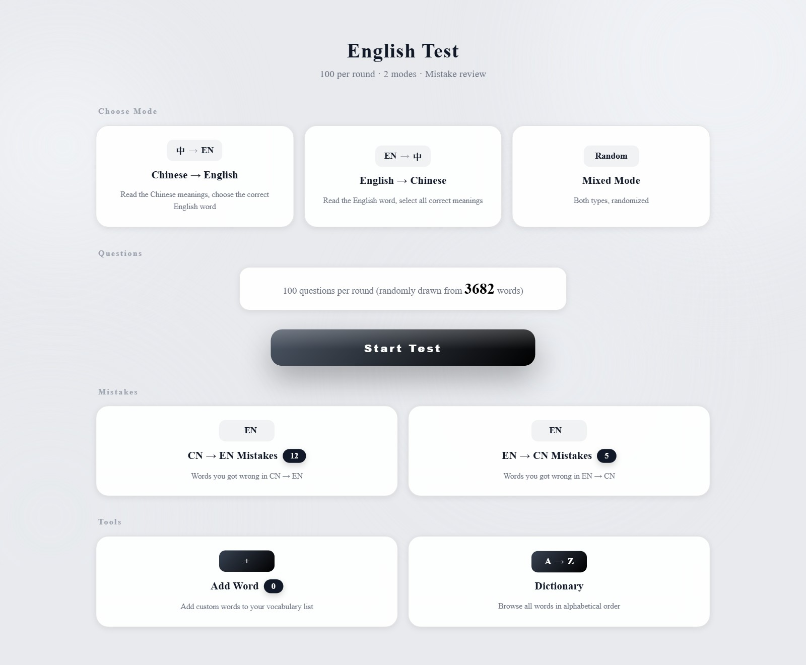
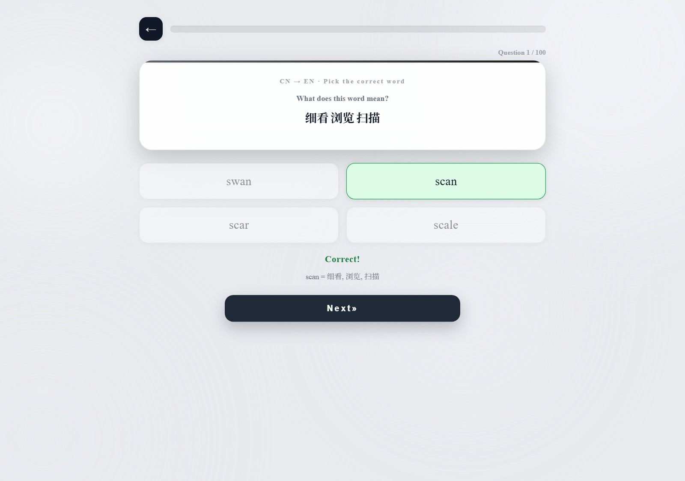
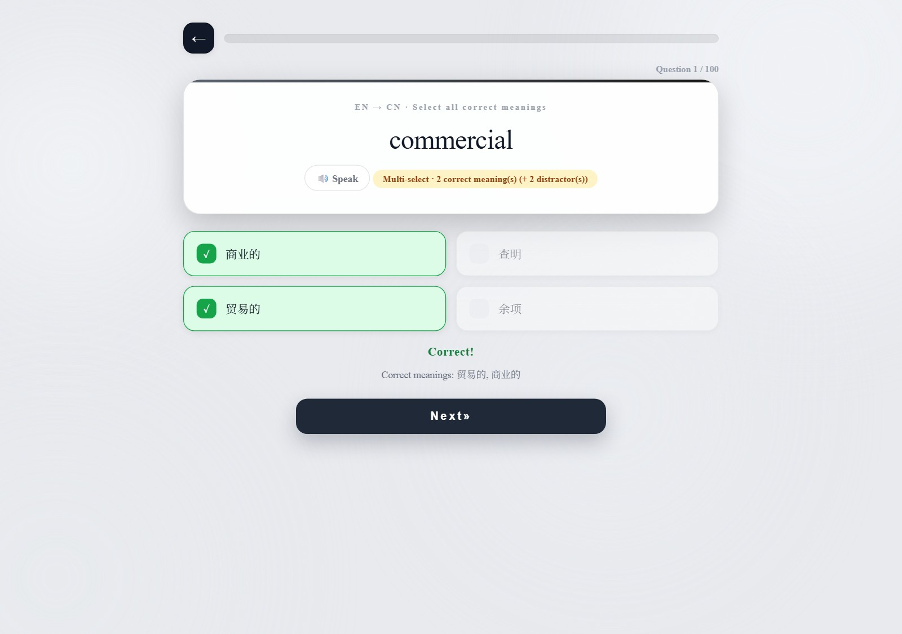
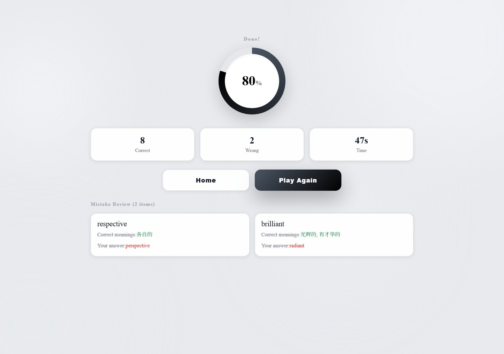
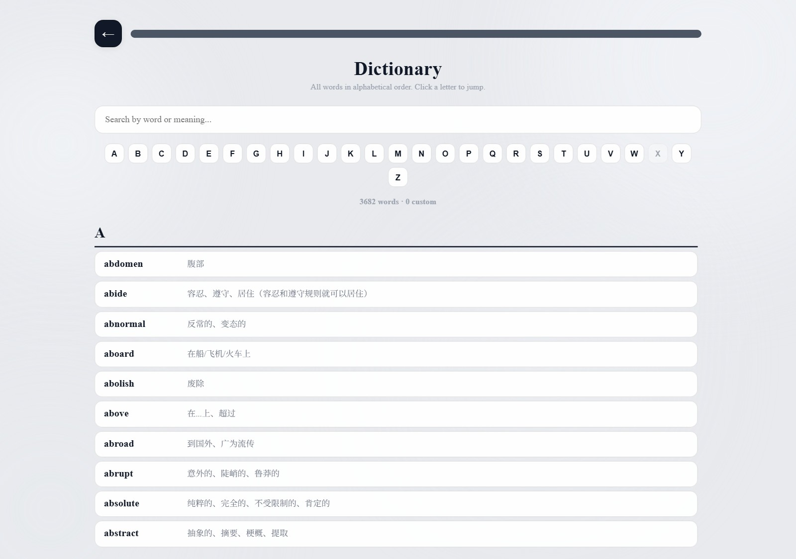

# English Test — Word Quiz

A fully offline English vocabulary trainer: **3682 words, 7237 Chinese meanings**, 100 questions per round, two question types, and two separate mistake books.

No network access, no accounts, no build step, no dependencies at runtime. The whole app is one self-contained HTML file; Electron is only a thin window around it.

[中文说明见文末](#中文说明) · [使用说明 (docs/usage-zh.md)](docs/usage-zh.md)

## Preview



| Chinese → English | English → Chinese |
|---|---|
|  |  |

| Results & mistake review | Dictionary |
|---|---|
|  |  |

## Features

- **Three modes** — `CN → EN` (read the meanings, pick the word), `EN → CN` (read the word, select *all* correct meanings), and `Mixed`.
- **100 questions per round**, drawn at random from the full list.
- **Confusable distractors.** Wrong options are not random — they are the nearest neighbours of the answer, so you actually have to know the word. See [How questions are generated](#how-questions-are-generated).
- **Two independent mistake books** (one per question type) with a review round and a per-word jump back into the list.
- **Custom vocabulary** — add words by hand, or bulk-import a text file; imported words join the quiz pool and the dictionary immediately.
- **Dictionary view** — all words A–Z, letter jump bar, search by English word *or* Chinese meaning.
- **TTS pronunciation** via the Web Speech API (offline voices).
- **Score ring, progress bar, timed rounds, mistake review** at the end of every round.
- Responsive layout; the window is resizable down to 720×560.

## Try it

### Zero install — just open the HTML

`index.html` is self-contained. Double-click it, or drag it into Chrome / Edge. Everything works, including the mistake books (they live in that browser profile's `localStorage`). Verified in Chrome with no console errors.

### Desktop app

Grab the portable build from [Releases](https://github.com/2049168557-blip/English-competition/releases) — unzip anywhere and run `English Test.exe`. No installer, no admin rights, and it keeps its data next to the exe, so you can carry it on a USB stick.

### Run from source

```bash
npm install
npm start
```

Requires Node.js and downloads Electron as a dev dependency. Needs no internet at runtime.

## Project layout

```
.
├── index.html      # the entire app: UI, styles, quiz engine, 3682-word dataset (249 KB)
├── main.js         # Electron window: portable userData path, single-instance lock, hardened webPreferences
├── package.json    # scripts for `npm start` and `npm run pack`
├── docs/
│   ├── usage-zh.md             # 中文使用说明
│   └── screenshots/            # images above
└── .github/workflows/
    └── build-windows.yml       # optional: builds the portable .exe on a tag
```

There is deliberately no bundler, framework or router. `index.html` holds all the application logic; `main.js` is ~50 lines of window setup.

## How questions are generated

**CN → EN** — the target word plus 3 distractors, shuffled into 4 options.

Distractors are ranked by a string-similarity score over the whole word list:

```
score = 1 − Levenshtein(a, b) / max(len)          # overall edit distance
      + 0.6 · shared prefix length / max(len)     # "respective" vs "perspective"
      + 0.3 · shared suffix length / max(len)     # "brilliant" vs "radiant"
```

The prefix/suffix bonuses are what pull in the pairs that look alike at a glance; plain edit distance alone would happily offer you unrelated words. The top 3 non-duplicate hits become the wrong options.

**EN → CN** — every correct meaning of the word, plus an equal number of distractors sampled from the pool of all 5501 distinct meanings (the word's own meanings excluded). All correct options must be selected, so a single-word entry still makes a meaningful question.

Both builders memoize per question index, so the 3682-word similarity scan for a given question runs once.

## Your data

Everything is stored locally in three `localStorage` keys:

| Key | Contents |
|---|---|
| `bcz_wrong_ce` | mistake book, CN → EN |
| `bcz_wrong_ec` | mistake book, EN → CN |
| `bcz_user_words` | your custom words |

The app makes **no network requests at all** — there is no `fetch`, `XMLHttpRequest`, WebSocket or remote asset reference anywhere in the source. In the Electron build, `main.js` also pins `userData` next to the executable, so moving the folder keeps your data.

## Adding your own words

**Add Word → Bulk Import** accepts a `.txt` / `.csv` / `.tsv` file, one entry per line:

```
# lines starting with # or // are ignored
ubiquitous 普遍存在的、无处不在的
proficient 熟练的，精通的
genuine 真正的 / 真诚的
```

The split point is the first Chinese character, so spaces, `=`, `:`, `-` and `→` between the word and the meaning are all handled. Meanings separate on `、` `，` `；` or `/`. Unparseable lines are listed in the preview with the reason, and you can tick off entries before importing.

## Building the portable .exe

```bash
npm run pack
```

Outputs `dist/English Test win32-x64/` — the ~270 MB folder you see in Releases. Roughly 269 MB of that is the Chromium runtime; this app contributes 249 KB. That ratio is normal for Electron.

A GitHub Actions workflow (`.github/workflows/build-windows.yml`) does the same on Windows whenever you push a `v*` tag, and uploads the result as a build artifact; upload it to Releases from there if you want it downloadable.

> Want the custom icon back: drop an `.ico` at `build/icon.ico` and add `--icon=build/icon.ico` to the `pack` script.

## 中文说明

一个完全离线的英语背单词工具，双击 `index.html`（浏览器）或 `English Test.exe`（桌面版）即可使用，不需要联网、不需要安装任何东西。

- 每轮 100 题，从 3682 个单词中随机抽取，共 7237 条中文释义
- 三种模式：中译英、英译中（多选全部正确释义）、混合模式
- 干扰选项不是随机抓的，而是按编辑距离 + 共同前缀/后缀算出的**形近词**，所以必须真的认识这个单词
- 两个独立错题本（中译英 / 英译中），可单独温习错题
- 支持手动加词和文本文件批量导入，自定义词会直接进入题库和词典
- 词典页可按字母跳转、按英文或中文搜索
- 单词朗读发音（TTS）
- 所有数据只存在本机 `localStorage`，代码中没有任何网络请求

更详细的使用方式见 [docs/usage-zh.md](docs/usage-zh.md)。

## License

MIT — see [LICENSE](LICENSE).
